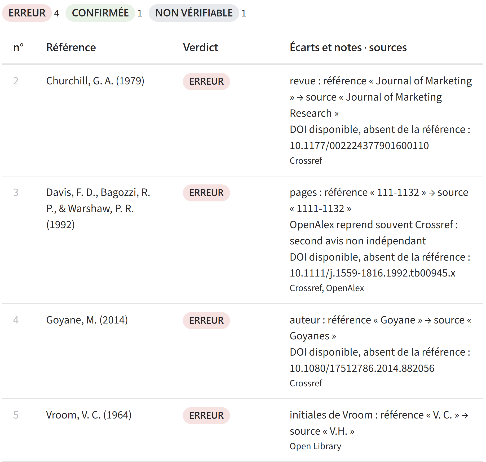

# verif-refs

[](https://doi.org/10.5281/zenodo.23372620)

**Audit de références bibliographiques, champ par champ, à partir de sources ouvertes.**

*English version: [README.md](README.md)*

verif-refs compare chaque référence d'une bibliographie aux notices de **Crossref**, **DataCite**, **OpenAlex** et **Open Library**, puis signale ce qui ne concorde pas : auteur omis ou mal orthographié, initiales fausses, ordre des auteurs inversé, mauvaise revue, volume, numéro ou pages erronés, sous-titre manquant, DOI disponible mais non cité.



**Essayer sans rien installer : [interface en ligne](https://huggingface.co/spaces/mbenabid/verif-refs)** — déposez un export Zotero (.bib, .ris), un manuscrit Word ou collez votre bibliographie.

> **Prototype de recherche, sans support garanti.** L'outil aide à repérer les problèmes ; il ne remplace pas une relecture. Un verdict CONFIRMÉE ne vaut **que pour les champs vérifiés**, et environ une référence sur quatre (livres anciens, rapports, presse, communications sans DOI) échappe aux sources consultées.

---

## Ce qui le distingue

- **Erreurs détaillées, pas seulement l'existence.** De nombreux outils vérifient qu'une référence existe (utile contre les références inventées par une IA). verif-refs indique *ce qui* diffère, sous la forme « champ : référence « X » → source « Y » ».
- **Des verdicts reproductibles.** Toutes les comparaisons, tous les verdicts et le décompte sont faits par du code déterministe. Lorsqu'un modèle de langage est utilisé (mode agent), il se limite à trier et recopier les références : il ne décide d'aucun verdict et ne peut fournir aucun DOI. Deux exécutions sur la même bibliographie donnent des résultats identiques.
- **Une fiabilité documentée.** L'outil a été évalué sur des bibliographies réelles, avec des corrigés et des prédictions établis avant chaque exécution. Méthode, résultats et limites : [docs/note_methodologique.md](docs/note_methodologique.md).

## Les cinq verdicts

| Verdict | Signification |
|---|---|
| **CONFIRMÉE** | Aucun écart sur les champs vérifiés. |
| **ERREUR** | La référence contredit la source (nom, initiales, revue, pages, année…). |
| **À VÉRIFIER** | Écart que la source ne permet pas de trancher (notice incomplète, nom composé…). |
| **À COMPLÉTER** | Rien de faux, mais un champ manque (volume, numéro, pages, sous-titre…). |
| **NON VÉRIFIABLE** | Aucune source ne contient le document (rapport, presse, chapitre, livre absent…). |

La colonne « écarts et notes » donne aussi, quand elle existe, la mention **« DOI disponible, absent de la référence »**.

---

## Trois façons de l'utiliser

### 1. En ligne, dans le navigateur

L'[interface en ligne](https://huggingface.co/spaces/mbenabid/verif-refs) ne demande ni installation, ni inscription, ni clé. Elle s'ouvre en français si votre navigateur est réglé en français, en anglais sinon ; un sélecteur permet de changer de langue à tout moment. Elle accepte jusqu'à 150 références par fichier et affiche les résultats au fur et à mesure ; le rapport se télécharge en .md et en .csv. Le fichier n'est pas conservé, mais le texte des références est envoyé aux services publics interrogés.

Pour héberger votre propre copie, voir [space/README.md](space/README.md) (le dossier `space/` contient l'application Gradio).

### 2. En ligne de commande, sans clé ni modèle de langage (recommandé pour les exports Zotero, Mendeley, EndNote)

Nécessite seulement **Python 3.10 ou plus récent**. Aucune bibliothèque à installer.

```bash
git clone https://github.com/mbenabid2109/verif-refs.git
cd verif-refs
python -m verif_refs.cli examples/exemple.bib --contact votre.adresse@universite.fr --lang fr
```

Formats acceptés : **.bib** et **.ris** (champs structurés, résultats les plus fiables), ainsi que **.txt**, **.md** et **.docx** (mode texte expérimental : le type de chaque référence est deviné par des règles simples). Pour un manuscrit Word, seule la section qui suit le titre « Références » ou « Bibliographie » est lue.

Le rapport est enregistré à côté du fichier : `…_verification.md` et `…_verification.csv` (s'ouvre directement dans Excel).

Sans `--lang fr`, le rapport est en anglais (`…_check.md` et `…_check.csv`).

L'option `--contact` transmet votre adresse à Crossref et OpenAlex, comme le demandent leurs règles d'usage.

### 3. Avec la chaîne d'agents Google ADK (pour les bibliographies en texte libre)

Un modèle de langage (Gemini) lit la bibliographie, reconnaît le type de chaque référence et en recopie les champs ; le code fait le reste.

```bash
python -m venv .venv
# Windows (PowerShell) : Set-ExecutionPolicy -Scope Process -ExecutionPolicy Bypass ; .venv\Scripts\Activate.ps1
# macOS / Linux        : source .venv/bin/activate
pip install -r requirements.txt
```

Copiez `verif_refs/.env.example` en `verif_refs/.env` et renseignez votre clé Gemini (gratuite sur [Google AI Studio](https://aistudio.google.com/app/apikey)) et votre adresse. Puis, **depuis le dossier `verif-refs`** :

```bash
adk web --port 8000
```

Ouvrez http://127.0.0.1:8000, choisissez **verif_refs**, puis écrivez par exemple : `Vérifie C:\Users\moi\Documents\manuscrit.docx`.

Le niveau gratuit de Gemini limite le nombre de requêtes par minute ; l'agent patiente et réessaie automatiquement. Comptez deux à quatre minutes pour une quarantaine de références.

> Ne publiez jamais votre fichier `.env` : il contient votre clé. Il est exclu du dépôt par `.gitignore`.

---

## Bien lire les résultats

- **ERREUR** : à examiner en priorité. Vérifiez la valeur indiquée dans la colonne « source », idéalement en ouvrant le DOI.
- **À VÉRIFIER** sur un **livre** signifie le plus souvent que la notice d'Open Library est incomplète (elle ne cite que le premier auteur, par exemple), pas que votre référence est fausse.
- **NON VÉRIFIABLE** sur un **article** de revue : la référence est peut-être trop incomplète pour être retrouvée (titre tronqué). Cherchez le titre sur le site de l'éditeur.
- Les sources elles-mêmes peuvent se tromper : Crossref contient parfois des métadonnées erronées, et OpenAlex les reprend souvent. L'outil le signale quand il le détecte.

## Fiabilité

Mesurée sur une bibliographie de validation jamais utilisée pendant le développement (43 références d'un article de *Political Communication*, corrigé et prédictions établis avant l'exécution) :

| Indicateur | Résultat |
|---|---|
| Précision (alertes correspondant à de vraies erreurs) | 19/20 (95 %) |
| Erreurs majeures détectées, parmi les références vérifiables | 19/20 (95 %) |
| Références non vérifiables (aucune source) | 11/43 (26 %) |
| Stabilité (résultats identiques sur deux exécutions) | 100 % |
| Fausses confirmations | 5 (dont 4 annoncées avant le test, toutes traitées dans les versions suivantes) |

Ces chiffres portent sur les versions 4.2 et 5.1. La version 5.2, publique, n'a pas encore été évaluée sur un corpus indépendant. Détails : [docs/note_methodologique.md](docs/note_methodologique.md).

## Limites connues

- Les communications de conférence sans DOI, les rapports, la presse, les thèses et les textes juridiques ne sont pas vérifiés.
- Les notices d'ouvrages d'Open Library sont souvent incomplètes ; les éditions françaises y sont mal couvertes.
- Les sous-titres manquants ne sont signalés que pour les articles.
- La version 5.2 corrige les fausses alertes observées sur des revues francophones (Persée, Cairn) et sur les notices d'ouvrages, mais **n'a pas encore été validée sur un corpus indépendant**. Voir l'addendum de la note méthodologique.

## Tests

La batterie de non-régression (103 cas, pour la plupart tirés de bibliographies réelles, notices simulées, sans accès au réseau ; elle vérifie aussi que chaque message a sa traduction anglaise) se lance avec :

```bash
python tests/run_all.py
```

Les tests de la chaîne d'agents et de l'interface web sont ignorés si Google ADK ou Gradio ne sont pas installés.

## Structure du dépôt

```
verif_refs/core.py    vérification déterministe (bibliothèque standard uniquement)
verif_refs/cli.py     ligne de commande, sans modèle de langage
verif_refs/i18n.py    traduction anglais / français des verdicts et des rapports
verif_refs/agent.py   chaîne d'agents Google ADK (chargeur → boucle par lots → rapport)
space/                interface web (Gradio, pour Hugging Face Spaces)
tests/                non-régression
data/                 corpus publics de développement et de validation, corrigé et prédictions
docs/                 note méthodologique (conception et évaluation)
examples/             fichier .bib d'exemple
```

## Citer cet outil

Benabid, M. (2026). *verif-refs : audit de références bibliographiques champ par champ* (version 5.2.0) [Logiciel]. Zenodo. https://doi.org/10.5281/zenodo.23372620

Voir aussi [CITATION.cff](CITATION.cff) ou le bouton « Cite this repository ». Si vous utilisez verif-refs dans une publication, merci de citer l'outil et de mentionner ses limites.

## Licence

MIT : voir [LICENSE](LICENSE).

## Remerciements

Le code a été écrit avec l'assistance d'un modèle d'IA (Claude, Anthropic). L'auteur a conçu l'outil, défini les règles de vérification, constitué les corpus d'évaluation et établi les corrigés et les prédictions avant chaque test, puis validé chaque version sur des bibliographies réelles. Les tests et l'évaluation sont documentés dans la note méthodologique.
