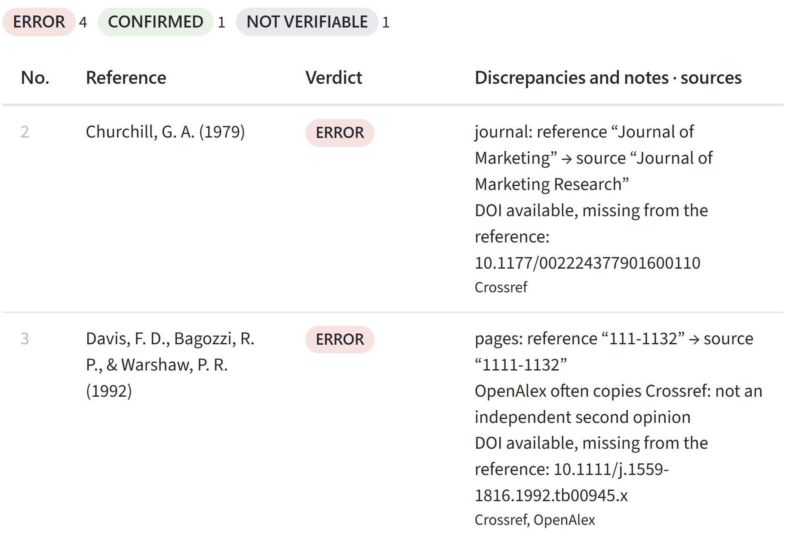

# verif-refs

**Field-by-field audit of bibliographic references against open sources.**

*Version française : [README.fr.md](README.fr.md)*

verif-refs compares each reference in a bibliography with the records of **Crossref**, **DataCite**, **OpenAlex** and **Open Library**, and reports what does not match: missing or misspelled author, wrong initials, author order, wrong journal, volume, issue or pages, missing subtitle, DOI available but not cited.



**Try it without installing anything: [online interface](https://huggingface.co/spaces/mbenabid/verif-refs)** — drop a Zotero export (.bib, .ris), a Word manuscript, or paste your bibliography.

> **Research prototype, no guaranteed support.** The tool helps spot problems; it does not replace proofreading. A CONFIRMED verdict applies **only to the fields that were checked**, and roughly one reference in four (old books, reports, press, conference papers without a DOI) is not covered by the sources queried.

The online interface and the command line are available in **English and French**; the tool works on references in any language, and handles French-language sources (Persée, Cairn, accents, double issues) particularly well.

---

## What makes it different

- **Detailed errors, not just existence.** Many tools check that a reference exists (useful against AI-fabricated references). verif-refs states *what* differs, as "field: reference "X" → source "Y"".
- **Reproducible verdicts.** All comparisons, verdicts and counts are computed by deterministic code. When a language model is used (agent mode), it only sorts and copies references: it decides no verdict and cannot supply any DOI. Two runs on the same bibliography give identical results.
- **Documented reliability.** The tool was evaluated on real bibliographies, with answer keys and predictions written before each run. Method, results and limits (in French): [docs/note_methodologique.md](docs/note_methodologique.md).

## The five verdicts

| Verdict | Meaning |
|---|---|
| **CONFIRMED** | No discrepancy on the fields checked. |
| **ERROR** | The reference contradicts the source (name, initials, journal, pages, year…). |
| **TO CHECK** | Discrepancy the source cannot settle (incomplete record, compound name…). |
| **INCOMPLETE** | Nothing wrong, but a field is missing (volume, issue, pages, subtitle…). |
| **NOT VERIFIABLE** | No source holds the document (report, press, chapter, missing book…). |

The notes column also flags **"DOI available, missing from the reference"**.

---

## Three ways to use it

### 1. Online, in the browser

The [online interface](https://huggingface.co/spaces/mbenabid/verif-refs) needs no installation, account or key. It opens in French if your browser prefers French, in English otherwise, and a switch changes the language at any time. It accepts up to 150 references per file and shows results as they come; the report downloads as .md and .csv. The file is not kept, but the reference texts are sent to the public services queried.

To host your own copy, see [space/README.md](space/README.md) (the `space/` folder holds the Gradio app).

### 2. Command line, no API key and no language model (recommended for Zotero, Mendeley, EndNote exports)

Requires only **Python 3.10 or later**. Nothing to install.

```bash
git clone https://github.com/mbenabid2109/verif-refs.git
cd verif-refs
python -m verif_refs.cli examples/exemple.bib --contact your.address@university.edu
```

Accepted formats: **.bib** and **.ris** (structured fields, most reliable results), plus **.txt**, **.md** and **.docx** (experimental text mode: reference types are guessed by simple rules). For a Word manuscript, only the section after a "Références"/"Bibliographie"/"References" heading is read.

The report is saved next to the file: `…_check.md` and `…_check.csv` (opens in Excel). Add `--lang fr` for a report in French (`…_verification.md` / `.csv`).

`--contact` passes your address to Crossref and OpenAlex, as their usage policies request.

### 3. With the Google ADK agent chain (for free-text bibliographies)

A language model (Gemini) reads the bibliography, recognises each reference type and copies its fields; the code does the rest.

```bash
python -m venv .venv
# Windows (PowerShell): Set-ExecutionPolicy -Scope Process -ExecutionPolicy Bypass ; .venv\Scripts\Activate.ps1
# macOS / Linux:        source .venv/bin/activate
pip install -r requirements.txt
```

Copy `verif_refs/.env.example` to `verif_refs/.env` and fill in your Gemini key (free at [Google AI Studio](https://aistudio.google.com/app/apikey)) and your address. Then, **from the `verif-refs` folder**:

```bash
adk web --port 8000
```

Open http://127.0.0.1:8000, choose **verif_refs**, and type for example: `Vérifie C:\Users\me\Documents\manuscript.docx`.

The agent chain works and reports in French. Gemini's free tier limits requests per minute; the agent waits and retries automatically. Expect two to four minutes for about forty references.

> Never publish your `.env` file: it contains your key. It is excluded by `.gitignore`.

---

## Reading the results

- **ERROR**: check first. Verify the value in the "source" column, ideally by opening the DOI.
- **TO CHECK** on a **book** usually means the Open Library record is incomplete (it lists only the first author, for instance), not that your reference is wrong.
- **NOT VERIFIABLE** on a **journal article**: the reference may be too incomplete to be found (truncated title). Search the title on the publisher's site.
- Sources can be wrong too: Crossref sometimes holds erroneous metadata, and OpenAlex often copies it. The tool says so when it detects it.

## Reliability

Measured on a validation bibliography never used during development (43 references from an article in *Political Communication*, answer key and predictions written before the run):

| Indicator | Result |
|---|---|
| Precision (alerts that were real errors) | 19/20 (95 %) |
| Major errors detected, among checkable references | 19/20 (95 %) |
| References not verifiable (no source) | 11/43 (26 %) |
| Stability (identical results over two runs) | 100 % |
| False confirmations | 5 (4 announced before the test, all addressed in later versions) |

These figures concern versions 4.2 and 5.1. Version 5.2, the public one, has not yet been evaluated on an independent corpus. Details: [docs/note_methodologique.md](docs/note_methodologique.md) (in French).

## Known limitations

- Conference papers without a DOI, reports, press articles, theses and legal texts are not checked.
- Open Library book records are often incomplete; French editions are poorly covered.
- Missing subtitles are flagged for articles only.
- Version 5.2 fixes false alarms seen on French-language journals (Persée, Cairn) and on book records, but **has not yet been validated on an independent corpus**. See the addendum to the methodological note.

## Tests

The regression suite (103 cases, mostly drawn from real bibliographies, simulated records, no network access; it also checks that every message has its English translation):

```bash
python tests/run_all.py
```

The agent-chain and web-interface tests are skipped if Google ADK or Gradio is not installed.

## Repository layout

```
verif_refs/core.py    deterministic checking (standard library only)
verif_refs/cli.py     command line, no language model
verif_refs/i18n.py    English / French translation of verdicts and reports
verif_refs/agent.py   Google ADK agent chain (loader → batch loop → report)
space/                web interface (Gradio, for Hugging Face Spaces)
tests/                regression tests
data/                 public development and validation corpora, answer key and predictions
docs/                 methodological note (design and evaluation, in French)
examples/             sample .bib file
```

## Citation

See [CITATION.cff](CITATION.cff). If you use verif-refs in a publication, please cite the tool and mention its limitations.

## Licence

MIT: see [LICENSE](LICENSE).

## Acknowledgements

The code was written with the assistance of an AI model (Claude, Anthropic). The author designed the tool, defined the verification rules, built the evaluation corpora, wrote the answer keys and predictions before each test, and validated each version against real bibliographies. Tests and evaluation are documented in the methodological note.
